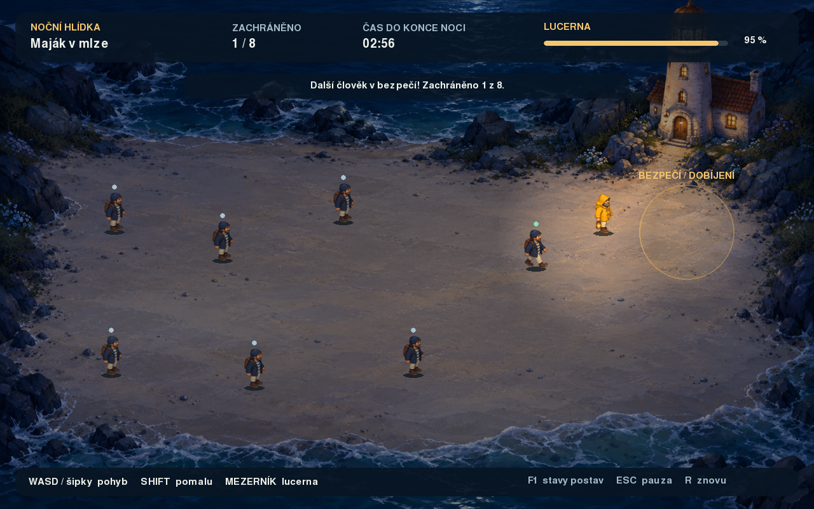

# 18. Maják v mlze

Samostatná výuková hra v pygame-ce. Jsi strážce majáku: najdi osm trosečníků a doveď je světlem lucerny do bezpečí, než uplynou tři minuty.



Celou tuto složku lze zkopírovat jinam. Hra nečte žádné soubory z ostatních příkladů workshopu. K běhu je potřeba Python a pygame-ce; grafika je přibalená a připojení k internetu během hry není potřeba.

## Spuštění

V terminálu otevři tuto složku. Na Windows:

```sh
py -m pip install -r requirements.txt
py main.py
```

Na macOS nebo Linuxu:

```sh
python3 -m venv .venv
source .venv/bin/activate
python -m pip install -r requirements.txt
python main.py
```

Pokud už máš připravené prostředí s pygame-ce, stačí v něm spustit `main.py`. Balíček se instaluje jako **pygame-ce**, v kódu se používá `import pygame`. Instalaci popisuje také [oficiální stránka pygame-ce](https://pypi.org/project/pygame-ce/). Verze v `requirements.txt` je verze použitá při ověřování této hry.

## Ovládání

| Klávesa / akce | Význam |
|---|---|
| WASD nebo šipky | Pohyb strážce |
| Držet Shift | Pomalá chůze pro doprovázení skupiny |
| Mezerník | Zapnout / vypnout lucernu |
| Escape | Pauza / pokračování; z výsledku návrat do menu |
| Enter | Zahájit hlídku, pokračovat z pauzy nebo hrát znovu |
| R | Okamžitě začít novou hlídku |
| F1 | Zobrazit názvy stavů, dosah světla a hranice pohybu |
| Myš | Tlačítka v menu, pauze a výsledku |

Po přepnutí do jiného okna se rozehraná hra pozastaví.

## Jak hrát

Přibliž se k postavě se zapnutou lucernou. Postava se uklidní a začne tě následovat. Doprovázej ji se Shiftem do zlatého kruhu před majákem. Záchrana se započítá, když do bezpečí vstoupí sám trosečník; nestačí, aby tam doběhl jen strážce.

Lucerna vydrží přibližně 28 sekund souvislého svícení mimo maják. V bezpečné zóně se automaticky dobíjí. Vybití samo o sobě neukončuje hru: můžeš se vrátit k majáku a dobít ji. Zhasnutí nebo příliš velká vzdálenost přeruší následování.

Na celou hlídku máš tři minuty. Vyhraješ záchranou všech osmi lidí. Po uplynutí času se ukáže výsledek a můžeš začít novou hlídku. Při pauze se čas i energie zastaví.

## Co je v této ukázce nové

Hlavním novým tématem je **stavový automat**: objekt si pamatuje svůj stav a podle něj volí chování. Stavy jsou obyčejné řetězce, žádný speciální framework.

| Stav trosečníka | Co dělá | Kdy se stav změní |
|---|---|---|
| `ztraceny` | Čeká na místě | V dosahu svítící lucerny začne následovat |
| `nasleduje` | Jde k místu vedle strážce | Bez světla nebo daleko od něj se vystraší; v bezpečí je zachráněn |
| `vystraseny` | Dvě sekundy stojí | Světlo ho uklidní; po dvou sekundách se vrátí do stavu `ztraceny` |
| `zachraneny` | Už se neúčastní pohybu | Konečný stav do začátku další hlídky |

Na hranici dosahu je malá rezerva 20 pixelů: již následující člověk neztratí kontakt okamžitě při nepatrném překročení kruhu. Při F1 lze změny stavů pozorovat přímo nad postavami. Barvy značek mají vedle názvů jen pomocný význam.

## V jakém pořadí číst kód

1. V `main.py` se podívej na konstanty a na funkci `nova_hra`. Uvidíš, odkud se berou postavy a jejich skupiny.
2. V `postavy.py` přečti `Strazce.update`: vstup → směr → posun → hranice → animace.
3. Přečti `Trosecnik.update`: nejprve podmínky přechodu, potom chování podle aktuálního stavu, nakonec ověření bezpečí.
4. Vrať se do `main.py` k označeným částem **EVENT**, **UPDATE** a **RENDER**. Herní smyčka navazuje na původní `05_template`.
5. Soubor `vykresleni.py` můžeš číst až potom. Obsahuje hotové funkce pro text, panely, menu, světlo a mlhu. Pouze zobrazují předaný stav a nemění pravidla hry.

Obrázky už mají připravené rozměry. Funkce `nacti_snimky` je jednoduše načte v pořadí 0–3; nemusíš při výkladu hry řešit ořezávání průhlednosti ani změnu velikosti. Vstup hráče je rozepsaný do čtyř samostatných podmínek, aby bylo vidět, jak každá klávesa mění směr.

## Rozdělení souborů

| Soubor | Úloha |
|---|---|
| `main.py` | Konstanty, načtení grafiky, tvorba hry a smyčka Event → Update → Render |
| `postavy.py` | Dvě třídy spritů, pohyb, animace a stavy trosečníků |
| `vykresleni.py` | Grafické pomocné funkce, světlo, mlha a menu |
| `grafika/pobrezi.png` | Pozadí herní plochy ve velikosti 1280 × 800 px |
| `grafika/strazce_0.png` až `strazce_3.png` | Čtyři připravené snímky strážce |
| `grafika/trosecnik_0.png` až `trosecnik_3.png` | Čtyři připravené snímky trosečníka |
| `requirements.txt` | Jediná externí závislost |
| `GRAFIKA.md` | Původ grafiky a zadání pro její vytvoření |
| `nahled.png` | Snímek skutečně vykreslené hry |

## Návaznost na starší příklady

- **03 – kostky:** třídy `Sprite`, skupiny, ovládání a prostorová interakce.
- **05 – template:** konstanty, inicializace a Event → Update → Render.
- **06 – auto:** plovoucí pozice `Vector2` a oddělení pozice od vykreslovacího obdélníku.
- **07 – animace:** střídání snímků podle času.
- **08 – obrázky:** jedna načtená sada snímků sdílená mezi více postavami; převrácené snímky se připraví jednou.
- **0x_SIM – simulace:** více jedinců s vlastním stavem a vlastní metodou `update`.

`pozice` zde znamená bod u nohou postavy. Obrázek se k němu zarovnává přes `rect.midbottom`. Díky tomu postavy různé šířky stojí na stejném místě. Pohyb používá sekundy (`dt`), nikoli počet vykreslených snímků. Diagonální směr se normalizuje, aby pohyb šikmo nebyl rychlejší.

## Co lze snadno vyzkoušet

- Změň `DOSAH_SVETLA`, `VYDRZ_LUCERNY` nebo `DELKA_NOCI` a sleduj změnu obtížnosti.
- Uprav rychlost trosečníka a porovnej ji s běžnou a pomalou chůzí strážce.
- Přidej další startovní místo do `MISTA_TROSECNIKU` a uprav texty, které mluví o osmi lidech.
- Změň chování vystrašeného člověka nebo přidej nový stav.
- Nahraď snímky vlastními PNG se stejnými názvy a výškou 62 px. Zachovej průhledné pozadí a nohy u spodního okraje.

Pláž má záměrně jednoduché obdélníkové hranice a průchozí vnitřek. Postavy nemají hledání cesty ani vzájemné pevné kolize; několik rozdílných cílových bodů omezuje jejich překrývání. Kód neobsahuje síť, ukládání výsledků, zvuk ani ochranné obaly pro chybějící soubory. Zaměřuje se na čitelnost a jeden hlavní nový koncept.

## Ověření

Ověřeno s Pythonem 3.12.10 a pygame-ce 2.5.8. Automatická kontrola skutečné herní smyčky zahrnula dokončení záchrany všech osmi lidí, vypršení časového limitu, menu, pauzu, restart, lucernu, dobíjení a spuštění z jiného pracovního adresáře. Prošlo 22 kontrol postav, 17 integračních kontrol a 5 kontrol překryvu světel. Výstupní obrazy menu, hry a výsledků byly vizuálně zkontrolovány. Testovací nástroje nejsou součástí této studentské složky.

Po zjednodušení kódu všechny kontroly znovu prošly. Sedm zachycených obrazovek je pixelově shodných s původní verzí. Celý průchod hrou prošel také z oddělené kopie této složky, včetně kontroly, že se všechny obrázky a herní moduly načítají pouze z ní.
