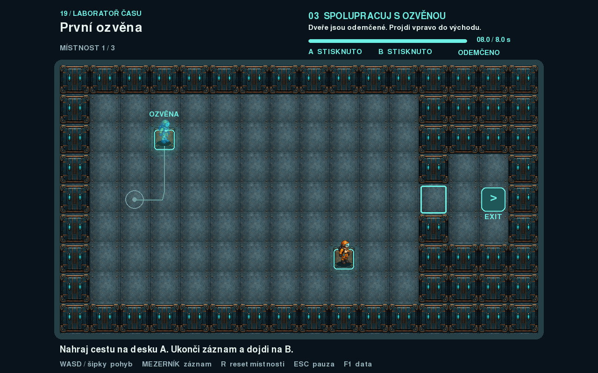

# 19. Ozvěny času

Samostatná výuková hra v pygame-ce. Nahraj krátkou cestu, nech ji přehrát svou ozvěnu a spolu s ní otevři dveře. Ve třech místnostech se postupně učíš využívat vlastní minulý pohyb.



Celou tuto složku lze zkopírovat jinam. Hra používá pouze soubory uvnitř této složky; nepotřebuje ostatní příklady workshopu. Grafika je přibalená. K běhu stačí Python a pygame-ce, během hraní není potřeba připojení k internetu.

## Spuštění

V terminálu otevři tuto složku. Na Windows:

```sh
py -m venv .venv
.venv\Scripts\python.exe -m pip install -r requirements.txt
.venv\Scripts\python.exe main.py
```

Na macOS nebo Linuxu:

```sh
python3 -m venv .venv
source .venv/bin/activate
python -m pip install -r requirements.txt
python main.py
```

Pokud už máš prostředí s pygame-ce, stačí v něm spustit `main.py`. Balíček se instaluje jako **pygame-ce**, ale v kódu se píše `import pygame`. Soubor `requirements.txt` používá verzi **2.5.8**.

## Ovládání

| Klávesa | Význam |
|---|---|
| WASD nebo šipky | Pohyb postavy |
| Mezerník | Začít nový záznam ze startu místnosti |
| Mezerník během nahrávání | Ukončit záznam a spustit přehrávání ozvěny |
| R | Restartovat aktuální místnost |
| Escape | Pauza / pokračování |
| Enter | Zahájit hru, pokračovat z pauzy nebo přejít do další místnosti |
| F1 | Zapnout / vypnout datový pohled |

## Jak hrát

1. Stiskni **mezerník**. Postava se vrátí na start místnosti a začne se nahrávat její pohyb.
2. Dojdi na desku **A** a zůstaň na ní. Dalším mezerníkem záznam ukonči. Nahrávání se samo ukončí nejpozději po **8 sekundách**.
3. Hráč se vrátí na start a objeví se tyrkysová ozvěna. Ta přehrává zaznamenanou cestu. Ty můžeš současně ovládat hráče a dojít na desku **B**.
4. Obě desky musí být obsazené zároveň alespoň **0,6 sekundy**. Pak se dveře otevřou a zůstanou otevřené do resetu místnosti. Už nemusíš držet desku a můžeš dojít k východu.

Ozvěna po přehrání **zůstává na posledním místě**. Není tedy nutné stihnout celou místnost během osmi sekund. Osm sekund omezuje délku nahrávky, nikoli čas na vyřešení místnosti. Desky A a B mají stejné pravidlo: jednu může držet hráč a druhou ozvěna.

Během samotného nahrávání se dveře neotevírají. Nejprve připravíš záznam, teprve při přehrávání ho využiješ. Ve hře je vždy nejvýše **jedna ozvěna**; nový záznam nahradí předchozí. Když se cesta nepovede, můžeš nahrát jinou nebo klávesou R restartovat místnost.

### Tři místnosti

| Místnost | Co si vyzkoušíš |
|---|---|
| První ozvěna | Záznam cesty a spolupráci hráče s ozvěnou na dvou deskách |
| Za zdí | Stejná pravidla s překážkou, kterou musíš obejít |
| Dlouhá vzpomínka | Delší nahranou cestu a čekání na desce, než dorazí ozvěna |

## Co je v této ukázce nové

Hlavním tématem je **záznam a přehrávání dat v čase**. Během nahrávání přidáváme do obyčejného seznamu malé n-tice:

```python
(cas, x, y, smer, snimek)
```

`cas` je počet sekund od začátku záznamu, `x` a `y` určují polohu postavy, `smer` určuje otočení obrázku a `snimek` vybírá obrázek animace. První záznam má čas 0. Z každého dalšího kroku hry si uložíme nový stav postavy.

Ozvěna pak postupuje tímto seznamem podle vlastního času. Když její čas leží mezi dvěma uloženými časy, metoda `lerp` dopočítá polohu mezi odpovídajícími body. Tomu se říká **lineární interpolace**. Přehrajeme-li záznam při jiném FPS, postava se stále pohybuje podle sekund.

Ukládáme už spočítané polohy. Ozvěna znovu nezpracovává klávesy ani kolize se zdmi. Nepřetáčíme celý svět: seznam obsahuje pouze pohyb jedné postavy. Dveře a desky se při přehrávání vyhodnocují podle aktuální situace.

## V jakém pořadí číst kód

1. V `main.py` najdi části **EVENT**, **UPDATE** a **RENDER**. Je to stejné rozdělení herní smyčky jako v `05_template`: vstup, změna stavu, vykreslení.
2. Sleduj, co provede mezerník. Najdi založení seznamu historie, přidávání n-tic a vytvoření ozvěny z hotového záznamu.
3. V `postavy.py` přečti `Hrac.update`. Čtyři podmínky pro klávesy sestaví směr, pohyb se řeší zvlášť v osách x a y, nakonec se vybere obrázek animace.
4. Přečti `Ozvena.update`. Sleduj čas, index v historii a výpočet polohy mezi dvěma záznamy. Ozvěna při čtení historii nemění.
5. Otevři `urovne.py`. Místnosti jsou slovníky s názvem, nápovědou a seznamem řetězců. Najdi v `main.py` místo, kde se znaky mapy mění na pozice a obdélníky.
6. Vrať se k vyhodnocení desek a dveří. Podmínka současného obsazení desek postupně plní časový čítač; otevření dveří je další stav hry.

Grafické pomocné funkce v `vykresleni.py` můžeš číst až potom. Pouze kreslí text, panely, záři a nabídky; nemění pravidla ani herní stav. Pro pochopení pravidel stačí hlavní smyčka, dvě třídy postav a data místností.

Obrázky mají konečnou velikost už na disku. `nacti_snimky` pouze načte čtyři PNG. Ozvěna dostává vlastní tyrkysové snímky, takže její třída řeší hlavně přehrávání historie. Průhlednost se nastaví jednou při načtení pomocí `set_alpha(170)`.

## Rozdělení souborů

| Soubor | Úloha |
|---|---|
| `main.py` | Načtení hry, nahrávání, desky a dveře, herní stavy a vykreslení |
| `postavy.py` | Hráč s kolizemi a ozvěna přehrávající historii |
| `urovne.py` | Tři místnosti v podobě ASCII map |
| `vykresleni.py` | Grafické pomůcky, menu, pauza a výsledková obrazovka |
| `grafika/hrac_0.png` až `hrac_3.png` | Čtyři připravené snímky hráče |
| `grafika/ozvena_0.png` až `ozvena_3.png` | Stejné pózy v tyrkysové barvě |
| `grafika/podlaha.png`, `zed.png`, `deska.png`, `dvere.png` | Dlaždice v konečné velikosti 64 × 64 px |
| `requirements.txt` | Jediná externí závislost: pygame-ce |
| `GRAFIKA.md` | Původ grafiky |
| `nahled.png` | Snímek skutečně vykreslené hry |

Každá mapa má 16 sloupců a 9 řádků. `#` znamená zeď, `.` podlahu, `S` start, `A` a `B` desky, `D` dveře a `E` východ. Při úpravách zachovej obvodové zdi a po jednom startu, obou deskách, dveřích a východu. Dveře musí stát v jediné cestě k východu.

## Návaznost na starší příklady

- **05 – template:** inicializace, konstanty a pořadí Event → Update → Render.
- **03 – kostičky:** objekty `Sprite`, ovládání a obdélníkové kolize.
- **07 – animace:** výběr snímku podle času a směru postavy.
- **08 – obrázky:** načtení a sdílení obrázků, předem připravené otočení doleva.
- **10 – tiles:** převod znaků a souřadnic mřížky na herní plochu.

Poloha je uložená jako `Vector2`, aby se neztrácely desetinné části pohybu. Kolizní obdélník `telo` má střed u nohou; vykreslovací `rect` drží celý obrázek. Díky oddělení obou obdélníků není hlava postavy překážkou při chůzi kolem zdi.

## Co lze snadno vyzkoušet

- Změň délku záznamu a zjisti, které cesty ještě stihneš nahrát.
- Uprav ASCII mapu druhé místnosti. Ověř, že zůstanou dosažitelné obě desky i dveře.
- Změň dobu potřebnou k otevření dveří a sleduj, jak se chová společné obsazení desek.
- Zapni F1 a porovnávej uložená data s pohybem ozvěny.
- Zkus ozvěnu po dohrání odstranit místo ponechání na posledním místě. Jak to změní postup řešení?
- Přidej čtvrtou místnost jako další slovník do seznamu `UROVNE`.

Kód je záměrně psaný přímo: běžné seznamy, n-tice, slovníky, podmínky a dvě jednoduché třídy. Nemá obecný herní engine ani obaly `try/except`. Předpokládá přibalené soubory a správně zapsané mapy, aby byl při čtení dobře vidět hlavní koncept.

`stav_hry` rozlišuje hraní, menu, pauzu a výsledek. `faze` říká, zda se připravuješ, nahráváš nebo přehráváš. `akce` je jednorázový povel ze vstupu, například začátek nového záznamu. Tyto proměnné mají odlišné úlohy; při pauze se fáze rozpracovaného pokusu zachová.

## Ověření

Ověřeno s Pythonem 3.12.10 a pygame-ce 2.5.8. Před zjednodušením i po něm prošlo 29 kontrol postav a 65 kontrol skutečné herní smyčky, včetně dohrání všech tří místností, záznamu, přehrávání, pauzy, restartu a ztráty fokusu. Šestnáct zachycených obrazovek je pixelově shodných s původní verzí. Celá hra prošla také z oddělené kopie této složky; všechny obrázky a herní moduly se načítaly pouze z ní. Automatické testy používají SDL dummy a nejsou součástí studentské složky.
